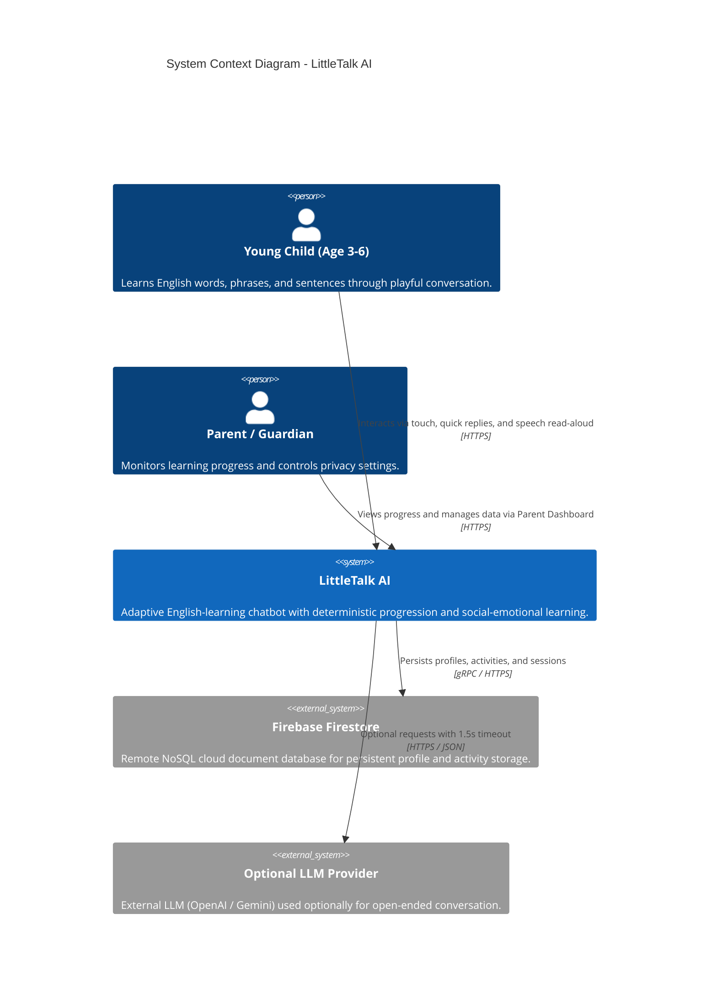
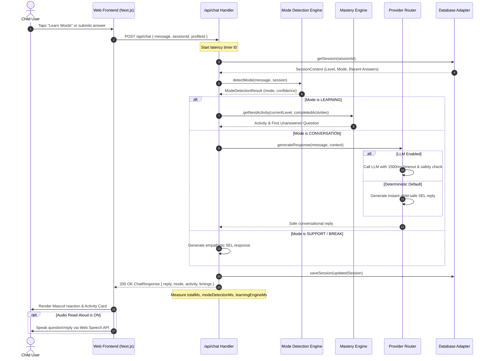
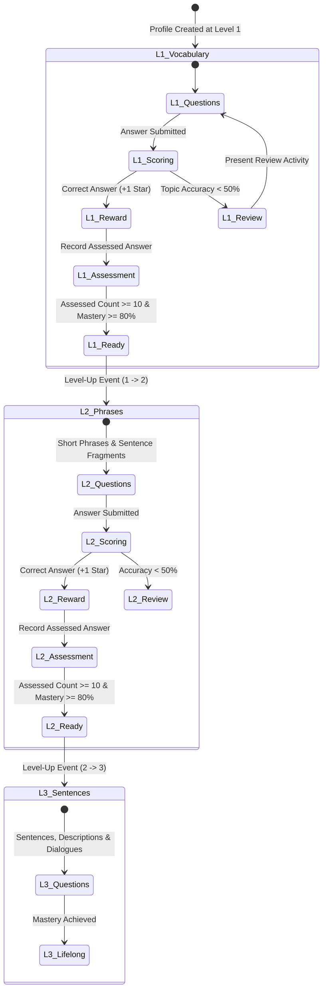
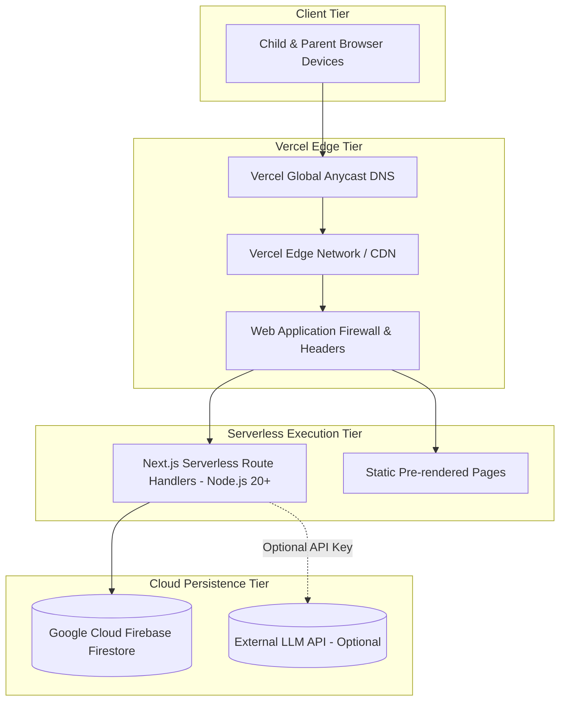

# LittleTalk AI - Architecture & Diagrams

This document contains architectural diagrams describing the production design of LittleTalk AI.

---

## 1. System Context Diagram (C4 Level 1)



---

## 2. Container & Component Architecture (C4 Level 2 & 3)

```mermaid
graph TD
    subgraph Browser Client [Frontend Client Application]
        A[Next.js App Router UI] --> B[HeaderBar Component]
        A --> C[Mascot SVG Controller - Lumi]
        A --> D[ModeSelector Component]
        A --> E[ActivityCard Component]
        A --> F[ChatInterface Component]
        A --> G[ParentModal Component]
        A --> H[Web Speech Synthesis API]
    end

    subgraph Serverless Backend [Next.js Route Handlers]
        I[/api/chat] --> J[Zod Payload Validator]
        K[/api/activity/answer] --> J
        L[/api/progress] --> J
        M[/api/session/reset] --> J
        N[/api/profile/delete] --> J

        J --> O[Mode Detection & State Machine]
        J --> P[SEL Emotional Response Engine]
        J --> Q[Mastery & Progression Engine]
        J --> R[Chat Provider Router]

        R --> S[Deterministic Rule Provider - Default]
        R -. Feature Flag .-> T[Optional LLM Provider]
        T --> U[Child Safety Guardrail Validator]
    end

    subgraph Storage Abstraction Layer
        Q <--> V[Database Adapter Interface]
        O <--> V
        V --> W[(In-Memory Demo Adapter)]
        V -. Configured .-> X[(Firebase Firestore Remote)]
    end
```

---

## 3. Chat & Activity Request Sequence Diagram



---

## 4. Learning-State & Mastery Progression Diagram



---

## 5. Deployment Diagram (Vercel Global Edge Network)


